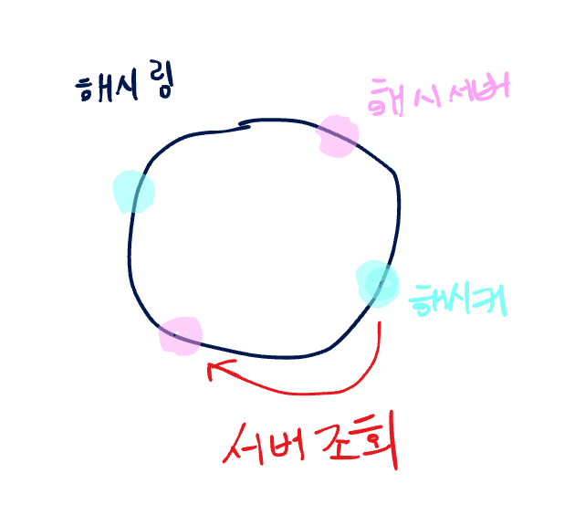
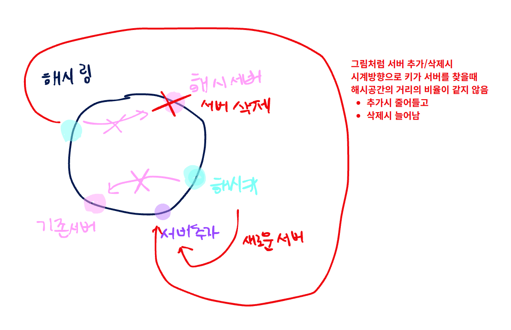

# 5장. 안정 해시 설계

> **책**: 가상 면접 사례로 배우는 대규모 시스템 설계 기초
> **읽은 날짜**: 2026-10-19
> **작성자**: @xrtro23

## 한 줄 요약
수평적 규모 확장성을 위해서 요청/데이터를 서버에 균등하게 나누는 것이 중요한데, 안정 해시는 효과적으로 균등하게 나누는 것이 가능하지만 서버 추가/삭제 등 변동이 일어나면 균등하게 나누기 어렵기 때문에 가상 노드를 사용한다.

## 핵심 내용

### 해시 키 재배치(rehash)
부하를 균등하게 나누는 방법 ex) 해시함수 : key 값이 분산되어 서버에 저장된다. 
예시) serverIndex = hash(key) % N
클라이언트는 해당 값에 따라 데이터를 가져오기 위해 해시 % 4 로 나눈 서버 인덱스에 접속해야 함

특징 : 서버 풀 크기가 고정되어 있거나 데이터 분포가 균등할때는 잘 동작한다
문제 : 서버가 추가되거나 기존 서버가 삭제되면 문제가 발생함 (풀의 크기가 변하기 때문에 키 분포가 바뀜)
결론 : 해시 함수는 불안정, 안정 해시 방식을 사용하자

### 안정해시
해시 테이블 크기가 조정될때 평균적으로 오직 (키/슬롯) 개의 키만 재배치 하는 해시 기술
전통적 해시 테이블 : 슬롯 수 변경시 대부분 키를 재배치

### 해시 공간
해시 함수가 만들어낼 수 있는 모든 해시 값의 범위

ex) 
- 사용한 해시 함수 : SHA-1
- 함수 출력 범위 : x0 ~ xn
- 해시 공간 범위 : 0 ~ $2^{160} - 1$

### 해시 링
해시 공간을 구부려서 양쪽을 접으면 해시 링이 만들어진다

### 해시 서버
안정 해시에서 해시 함수를 이용해 해시 공간에 배치한 서버
해시 함수를 사용하면 서버 IP/이름을 해시 링 위치에 대응 할수 있다.
* 별도의 서버를 가지고 있는 개념은 아님

### 해시 키
해시 함수에 입력하여 해시값을 생성하는 기준 데이터로 해시 링에 배치한다.

### 서버 조회
키가 저장되는 서버기준은 해당 키 위치에서 시계방향으로 링을 돌아 만나는 첫번째 서버이다.
각 키는 해시링을 따라 각 서버에 저장됨.

### 서버 추가
안정해시는 (키/슬롯) 개의 키만 재배치 하는 해시 기술이기 떄문에
서버 추가시에는 키 카운데 일부만 재배치 된다.
ex)
기존서버 : 4개
기존키 : 4개
서버추가시 : 4/5 = 0.8 (재배치)

### 서버 제거
키 카운데 일부만 재배치
서버 추가와 동일하며 나머지 키에 영향이 없다

### 그림 - 해시 구조

### 그림 - 서버 추가/삭제시 해시 분포

### 기본 구현법
목적
- 균등 분포 해시 함수를 사용해 서버와 키를 해시 링에 배치
- 키는 위치에서 시계방향에서 만나는 최초의 서버에 저장

문제
- 서버 추가/삭제시 파티션 균등하게 유지 불가능 ex) 어떤 서버는 다른 서버의 2배 값을 가질수도 있음
- 키의 균등 분포가 어려움

해결
- 가상 노드(복제) 사용

### 파티션
인접한 서버 사이의 해시 공간

### 가상 노드
- 실제 노드나 서버를 가리키는 노드로 한 서버는 여러개의 가상 노드를 가질수 있음
- 하나의 실제 서버를 해시 링의 여러 위치에 배치하기 위해 만든 논리적인 노드

사용 목적
- 기존 안정 해시의 데이터의 균형이 맞지 않는 문제 개선 목적

** 장점 ***
- 가상 노드의 개수를 늘리면 표준 편차가 작아져서 데이터가 고르게 분포되어 키의 분포가 점점 균등해진다.

** 단점 **
- 가상 노드를 늘리면 데이터를 저장할 공간이 더 필요함

* 기존 안정해시 방식 차이 (** 가상노드도 안정해시 개념이나 정리하기 위해 분리 **)
안정해시 : 서버가 링의 한 위치에 고정
가상노드 : 서버가 여러 위치에 있을수 있다

### 재배치 키 결정 예시 (해시링 분포)
ex) k0 - s0 - k1 - s1 - k2 - s2- k3 - s3
서버 추가/삭제시 일부 데이터를 재배치해야 함

서버추가 (s4)
- 위치 : s1 앞
- 재배치 : k0은 s1 → s4 로 변경

서버 삭제 (s1)
- 재배치 : k1,k2는 s1 → s2로 변경

### 마무리 (=전체적으로)
서버 추가/삭제 시에도 안정적으로 대응이 가능한 방식인 가상 노드 안정해시 방식으로
적절한 데이터 공간이 허용하는 내에서 가상노드를 많이 사용하여 데이터를 고르게 분포하자

## 인상 깊은 구절

> **가상노드의 개수를 늘리면 키의 분포는 점점 더 균등해진다. 그러나 가상 노드 데이터를 저장할 공간은 더 많이 필요하게 될 것이다. 타협적 결정이 필요하다**
> — 5장 87P

**왜 인상 깊었나:**
가상 노드를 늘리면 서비스의 성능과 안정성을 높일 수 있지만, 그만큼 저장 공간이 많이 필요해 운영 비용이 증가하는 것처럼 모든 선택에는 얻는 것과 포기해야 하는 것이 존재한다.
이는 시스템 설계뿐만 아니라 현실에서도 마찬가지라고 생각한다. 내가 원하는 결과를 추구할수록 포기하는게 많아진다.
시간이 될수도 있고, 비용이 될수도 있고 여러 문제가 생기는데
결국 모든 것을 만족시키는 완벽한 선택보다는, 주어진 환경에서 무엇을 우선하고 무엇을 타협할지 판단하는 것이 중요하다는 점에서 인상 깊었다.

## 더 알아볼 것
- [ ] 해시에 대한 개념 추가 파악 및 그림으로 이해하기
- [ ] 가상 노드 방식 활용법 예시

## 참고 자료
- 가상 면접 사례로 배우는 대규모 시스템 설계 기초 5장
