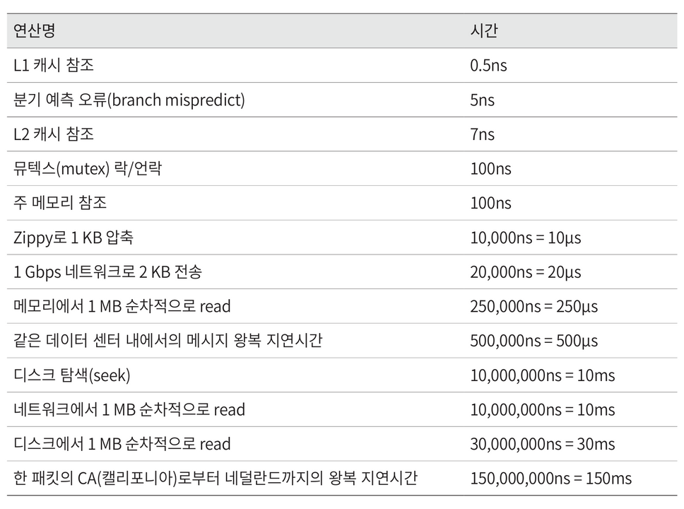

# 2장. 개략적인 규모 추정

> **책**: 가상 면접 사례로 배우는 대규모 시스템 설계 기초
> **읽은 날짜**: 2026-10-13
> **작성자**: @seoungyeolmaeng

## 한 줄 요약
개략적인 규모 추정(back-of-the-envelope estimation)을 잘 하기 위해서 규모 확장성을 표현하는 기본기와 올바른 가정과 절차가 필요하다. 

## 핵심 내용

### 2의 제곱수
- ASCII 문자 하나가 차지하는 메모리 크기가 1바이트, 8비트로 구성된다. 이는 CPU가 메모리 주소를 지정할 수 있는 최소 단위이다. 
- 2^10 B ≈ 1 KB, 2^30 B ≈ 1 GB, 2^40 B ≈ 1 TB

### 모든 프로그래머가 알아야 하는 응답지연 값 (Jeff Dean 기준)

- 메모리는 빠르지만 디스크는 아직도 느리다. 
- 디스크 탐색은 가능한 한 피하라. 
- 단순한 압축 알고리즘은 빠르다. 
- 데이터를 인터넷으로 전송하기 전에 가능하면 압축하라. 
- 데이터 센터는 보통 여러 지역에 분산되어 있고, 센터들 간에 데이터를 주고받는 데는 시간이 걸린다. 

### 가용성에 관계된 수치들
- 고가용성 : 오랜 시간 동안 시스템이 중단 없이 지속적으로 운영되는 능력 

### 예제: 트위터 QPS와 저장소 요구량 추정
- 월간 능동 사용자 (Monthly Active User)
- 일간 능동 사용자 (Daily Active User)
- QPS (Query Per Second)

### 팁
1. 근사치를 활용한 계산 (rounding and approximation) 
2. 가정 (assumption)
3. 단위 꼭 쓰기 (unit)
4. 빈출 개략적 규모 추정 문제 (QPS / 최대 QPS / 저장소 요구량 / 캐시 요구량 / 서버 수) 

## 인상 깊은 구절
> 개략적 규모 추정을 효과적으로 해 내려면, 규모 확장성을 표현하는 데 필요한 기본기에 능숙해야 한다. 특히, 2의 제곱수, 응답지연 값, 그리고 가용성에 관계된 수치들을 기본적으로 잘 이해하고 있어야 한다. 개략적인 규모 추정(back-of-the-envelope estimation)은 보편적으로 통용되는 성능 수치상에서 사고 실험을 행하여 추정치를 계산하는 행위로서, 어떤 설계가 요구사항에 부합할 것인지 보기 위한 것. 
>
> — p.33
**왜 인상 깊었나:**
평소 생각해본 적 없었던 주제들이라, 개략적 규모 추정하는데 어떤 요소들을 고려해야하는지 배울 수 있게되어 인상 깊었다. 
--- 
> 개략적인 규모 추정과 관계된 면접에서 가장 중요한 것은 문제를 풀어 나가는 절차다. 올바른 절차를 밟느냐가 결과를 내는 것보다 중요하다. 
>
> — p.37
**왜 인상 깊었나:**
적절한 규모를 추정해야 올바른 아키텍처를 선택할 수 있고 비용도 절약할 수 있기 때문에 "규모 추정"이 매우 중요한 과정이라는 것을 느꼈다.  

## 면접 예상 질문
1. **Q. 시스템 설계 면접에서 개략적인 규모 추정은 왜 하고, 어떤 절차로 진행하는가?**

   **A.** 정확한 값을 구하려는 것이 아니라, 요구사항을 감당하려면 어느 정도의 처리량과 저장 용량이 필요한지 가늠해 올바른 아키텍처를 고르고 비용을 줄이려는 것이다. 면접에서는 결과값보다 절차가 더 중요하다. 먼저 가정을 하고 그다음 계산을 단순하게 하려고 근사치로 반올림한다. 모든 값에 정확한 단위를 붙인다. 마지막으로 QPS, 최대 QPS, 저장소 요구량, 캐시 요구량, 서버 수 같은 빈출 항목도 필요하다면 얘기한다. 

2. **Q. 응답지연 값(Jeff Dean의 latency numbers)을 보고 지연시간을 최소화하기 위한 설계 방법은?**

   **A.** 메모리는 빠르지만 디스크는 아직도 느리다는 점이 출발점이다. 
   * *첫째, 메모리 캐시 적극 활용:* 메모리는 디스크보다 수만 배 이상 빠르므로, 자주 읽는 데이터는 메모리 캐시(Redis, 로컬 메모리)에 둔다.
   * *둘째, 디스크 탐색(Seek) 회피:* 디스크 탐색은 매우 비싼 연산이므로, 무작위 접근(Random Access) 대신 순차적 읽기/쓰기(Sequential I/O) 방식을 활용한다.
   * *셋째, 전송 전 데이터 압축:* 단순한 압축 알고리즘은 매우 빠르므로, 데이터를 인터넷으로 전송하기 전에 압축하여 네트워크 전송 시간을 줄인다.
   * *넷째, 데이터 센터 간 호출 최소화:* 데이터 센터 간 왕복 지연시간(RTT)은 수십~수백 밀리초에 달하므로, 센터 간 통신을 줄이고 사용자와 가까운 엣지/CDN에서 처리하도록 설계한다.

3. **Q. QPS와 최대 QPS는 어떻게 추정하며, 고가용성은 어떻게 표현하는가?**

   **A.** QPS는 초당 처리하는 요청 수다. 먼저 MAU로부터 DAU를 가정하고, 사용자당 하루 요청 수를 곱해 하루 총 요청 수를 구한다. 이를 하루 초 수(약 86,400초, 근사하면 10^5초)로 나누면 평균 QPS가 된다. 최대 QPS는 보통 평균의 2배 정도로 가정한다. 고가용성은 시스템이 오랜 시간 중단 없이 운영되는 능력이며, 보통 가동률(99.9% 등)로 표현한다. 가동률이 한 단계 올라갈 때마다 허용되는 다운타임이 크게 줄어든다. 대부분의 클라우드 서비스는 99% 이상의 가용성을 SLA로 제시한다.

## 실무 적용점

<!-- 지금 하는 일 / 사이드 프로젝트에 어떻게 적용할 수 있을까? -->

- [ ]

## 더 알아볼 것
- 메모리는 빠르지만, 디스크는 아직도 느린 이유가 뭔지? 
- 디스크 탐색의 의미가 CPU에서 데이터를 조회하고 값을 불러오기 위해 하드 디스크로 넘어가는걸 의미하는지?
- 디스크 탐색이 왜 가장 비싼 연산인지? 
- CPU 연산 뿐만 아니라 컴퓨팅 계산시에 (예를 들면, 텐서나 행렬 계산, AI Train 등) CPU에서 GPU로 넘어가고 하는 자세한 과정과 어떤 계산시에는 어디 과정에서 병목인지 알아보기
- 단순한 압축 알고리즘의 예시?   
- 현재 업계에서 고가용성을 달성하기 위한 주요 방법으로 무엇이 있는지? 
- QPS(Query Per Second)의 의미와 트위터 예시 말고 다른 서비스에서의 QPS 예시 

## AI 활용 기록
| 막힌 곳 | 어떻게 풀었나 | 검증 |
| --- | --- | --- |
| 메모리는 빠르고 디스크는 느린 이유, 디스크 탐색의 의미와 가장 비싼 연산인 이유 | "더 알아볼 것"의 질문 3개를 AI에게 그대로 물음. 탐색(seek)은 CPU가 디스크로 넘어가는 게 아니라 디스크 헤드를 읽을 위치로 옮기는 동작이고, 헤드 이동에 회전 지연이 더해져 느리다고 정리됨 | 🟢 검증 완료 — 책 표(RAM 100ns vs 디스크 탐색 10ms, 10만 배 차이)와 일치. 7,200rpm 디스크 회전 지연(1회전 8.33ms / 평균 회전 지연 4.17ms) 및 헤드 기계적 이동 비용이 맞음을 확인 |
| CPU에서 GPU로 넘어가는 과정과 병목 위치 | AI에게 학습 한 스텝의 흐름(디스크 → RAM → PCIe → GPU 메모리 → 연산)과 단계별 병목(데이터 로딩, PCIe 전송, GPU 메모리 대역폭, 연산량, GPU 간 통신)을 표로 정리하게 함 | 🟢 검증 완료 — PyTorch 데이터로더(pin_memory, prefetch) 및 NVIDIA CUDA 가이드(PCIe 병목, Memory vs Compute-bound, NCCL 분산 통신) 표준 아키텍처와 정확히 일치 |
| 단순한 압축 알고리즘의 예시 | LZ4, Snappy는 빠르고, gzip·brotli는 압축률 중심, zstd는 중간이라고 정리됨 | 🟢 검증 완료 — 책 p.34의 Zippy(=Google Snappy) 지연시간 표(10µs)와 일치. Kafka·RocksDB 기본 코덱(LZ4/Snappy의 고속 특성) 및 HTTP 표준(gzip) 분류 적합성 확인 |
| 업계에서 고가용성을 달성하는 방법 | SPOF 제거, 로드밸런서와 헬스 체크, 복제·failover, 다중 AZ·리전, 서킷 브레이커, 카나리 배포 등으로 분류해 줌 | 🟢 검증 완료 — 책 p.35 가용성 표(연간 다운타임: 99.9% 8.77시간, 99.99% 52.6분)와 일치. Google SRE 및 AWS Well-Architected 프레임워크 핵심 패턴에 부합 |
| QPS의 의미와 트위터 외 서비스 예시 | 같은 계산 틀(DAU × 요청 수 ÷ 86,400)을 쇼핑몰(약 580)·메신저(약 46,000)에 적용해 보게 함. 가정은 임의 값 | 🟢 검증 완료 — 계산 공식(쇼핑몰 50M/86.4k=578.7≒580, 메신저 4B/86.4k=46,296≒46,000) 산술 검증 완료. 책의 트위터 예제 계산 절차와 동일한 논리 확인 |

> 자세한 내용: [규모 추정 "더 알아볼 것" 정리](../../../ai-log/yeol/2026-10-13-규모-추정-더-알아볼-것.md)

## 참고 자료
- 가상 면접 사례로 배우는 대규모 시스템 설계 기초 
