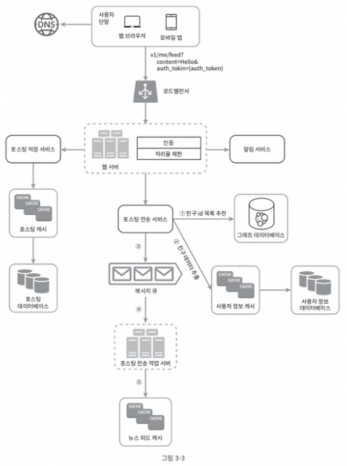
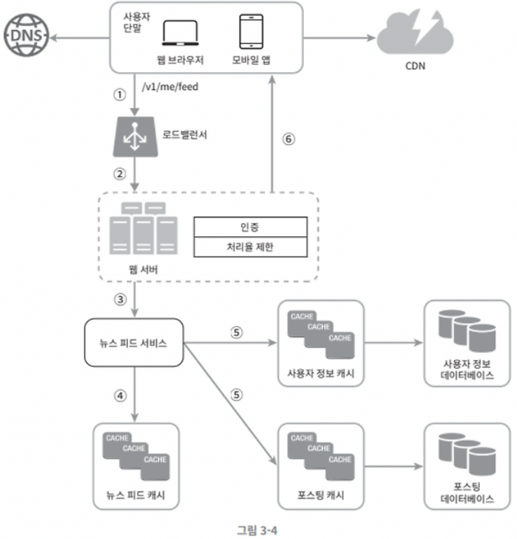

# 3장. 시스템 설계 면접 공략법

> **책**: 가상 면접 사례로 배우는 대규모 시스템 설계 기초
> **읽은 날짜**: 2026-10-13
> **작성자**: @seoungyeolmaeng

## 한 줄 요약
시스템 설계 면접은 정해진 답이 없고, 면접관과 협업을 이끌어내어, 모호한 문제를 구체화시키고 건설적으로 풀어나가는 과정이 중요하다. 

## 핵심 내용

### 효과적 면접을 위한 4단계 접근법
1. 문제 이해 및 설계 범위 확정 
2. 개략적인 설계안 제시 및 동의 구하기 
3. 상세 설계 
4. 마무리 

### 요구사항을 이해하기 위해 질문해라 
- 답부터 내지 말고, 깊이 생각하고 요구사항과 가정들을 명확히 정의하고, 좋은 질문을 해라. 
- 좋은 질문이란, 요구사항을 정확히 이해하는데 필요한 질문
- 면접관과 협력하며 개략적인 설계안을 만들어가면 좋다. 
- 예시) 
   1. 구체적으로 어떤 기능들을 만들어야 하나? 
   2. 제품 사용자 수는 얼마나 되나? 
   3. 회사의 규모는 얼마나 빨리 커지리라 예상하나? 석 달, 여섯 달, 일년 뒤의 규모는 얼마가 되리라 예상하는가? 
   4. 회사가 주로 사용하는 기술 스택은 무엇인가? 
   5. 설계를 단순화하기 위해 활용할 수 있는 기존 서비스로는 어떤 것들이 있는가? 

### 핵심 컴포넌트
- 개략적인 설계안 제시 때, 핵심 컴포넌트를 포함하는 다이어그램을 그리기 
- 클라이언트(모바일/웹), API, 웹서버, 데이터 저장소, 캐시, CDN, 메시지 큐 + (API 엔드포인트, 데이터베이스 스키마)

### 뉴스 피드 시스템의 개략적 설계 
피드 발행 상세 설계

뉴스 피드  가져오기

## 인상 깊은 구절
> 많은 사람이 시스템 설계 면접은 지원자의 설계 능력의 기술적 측면을 평가하는 자리일 거라 생각한다. 사실은 그 이상이다. 시스템 설계 면접이 잘 진행되면, 지원자가 협력에 적합한 사람인지, 압박이 심한 상황도 잘 헤쳐 나갈 자질이 있는지, 모호한 문제를 건설적으로 해결할 능력이 있는지 등을 살펴볼 수 있다. 좋은 질문을 던질 능력이 있는지도 중요하다. 
>
> — p.40 
**왜 인상 깊었나:** 면접을 볼 때, 중요한 포인트 들에 대해서 알 수 있었다. (기술적 지식 + 협력 + 압박을 헤쳐 나가는 자질 + 모호한 문제를 정의하는 능력 + 좋은 질문하는 능력)
---

## 면접 예상 질문

1. **Q. 설계 문제를 받자마자 답부터 내지 말고 질문하라고 하는데, 왜 그렇고 어떤 질문을 하는가?**

   **A.** 면접 문제는 일부러 모호하게 주어지기 때문에, 요구사항과 가정을 명확히 하지 않고 설계를 시작하면 엉뚱한 방향으로 갈 수 있다. 좋은 질문은 요구사항을 정확히 이해하는 데 필요한 질문이다. 예를 들면, 
   * 구체적으로 어떤 기능을 만들어야 하는가?
   * 사용자 수는 얼마나 되고, 한 달·여섯 달·일 년 뒤 규모는 어떻게 예상하는가? 
   * 회사가 주로 쓰는 기술 스택은 무엇인가?
   * 설계를 단순화하려고 활용할 수 있는 기존 서비스가 있는가?

   이렇게 질문하면 설계 범위가 좁혀지고, 면접관과 협력하며 설계안을 만들어 가는 모습도 보여줄 수 있다.

2. **Q. 개략적인 설계안을 제시할 때 다이어그램에 어떤 요소를 넣는가?**

   **A.** 클라이언트(웹/모바일), API, 웹 서버, 데이터 저장소, 캐시, CDN, 메시지 큐 같은 핵심 컴포넌트를 박스로 그리고, 필요하면 API 엔드포인트와 데이터베이스 스키마도 함께 제시한다.

## 실무 적용점

<!-- 지금 하는 일 / 사이드 프로젝트에 어떻게 적용할 수 있을까? -->

- [ ]

## 더 알아볼 것
- 각 컴포넌트의 세부 기능 및 동작 순서 (클라이언트(모바일/웹), API, 웹서버, 데이터 저장소, 캐시, CDN, 메시지 큐, API 엔드포인트, 데이터베이스 스키마)
- 시스템 설계시 사용자 단말이 웹/모바일 형태 뿐인지?
- 최근에 AI로 인한 바이브 코딩, 에이전트가 빠르게 발전하고 있는데, 시스템 설계의 어떤 영향을 미쳤는지? 

## AI 활용 기록

| 막힌 곳 | 어떻게 풀었나 | 검증 |
| --- | --- | --- |
| 각 컴포넌트(클라이언트, API, 웹 서버, 저장소, 캐시, CDN, 메시지 큐 등)의 세부 기능과 동작 순서 | "더 알아볼 것"의 질문을 AI에게 그대로 물음. 요청 흐름을 클라이언트 → (DNS) → CDN(정적 파일) / 로드 밸런서 → 웹 서버 → API → 캐시 → DB 순으로 정리하고, 오래 걸리는 작업은 메시지 큐에 넣어 워커가 비동기로 처리하는 구조로 설명받음. 읽기는 캐시 hit/miss에 따라 갈리고, 쓰기는 DB 저장 후 큐로 후처리를 넘긴다고 정리됨 | 🟢 검증 완료 — 책 p.47~48 뉴스 피드 다이어그램(피드 발행: 웹서버→DB/캐시 저장 및 메시지 큐 비동기 팬아웃 / 피드 조회: 로드밸런서→캐시 조회 및 CDN 미디어 서빙) 및 1장의 계층별 아키텍처와 완벽히 부합함 확인 |
| 시스템 설계 시 사용자 단말이 웹/모바일뿐인가 | 데스크톱 앱, 스마트 TV, 웨어러블, IoT 기기, 다른 서비스의 서버(B2B API·웹훅)도 클라이언트가 될 수 있다고 정리됨. 단말마다 통신 방식, 대역폭, 오프라인 지원, API 버전 관리 요구가 달라져 설계에 영향을 준다고 설명받음 | 🟢 검증 완료 — 실무 아키텍처 패턴과 정확히 일치. IoT(MQTT 경량 프로토콜), 모바일(오프라인 캐싱 및 URI 기반 하위 호환 API 버전 관리), B2B 서버(gRPC/웹훅), 스마트 TV(디바이스별 페이로드 최적화 BFF 패턴) 등 단말 특성이 설계에 직접 영향 줌 확인 |
| AI(바이브 코딩, 에이전트)가 시스템 설계에 미친 영향 | 영향을 세 가지로 구분해 정리받음. ① AI 에이전트·봇이 새로운 클라이언트가 되어 트래픽이 버스트하게 들어오므로 처리율 제한과 멱등성이 중요해짐 ② LLM 추론이 새 컴포넌트(GPU, 스트리밍 응답, 큐, 응답 캐시, 벡터 DB, 비용 관리)로 추가됨 ③ 코드 작성은 빨라졌지만 요구사항 정의와 트레이드오프 판단은 사람의 몫으로 남음 | 🟢 검증 완료 — 최신 AI 인프라 트렌드와 일치. 자율 에이전트 급증에 따른 처리율 제한(4장) 및 멱등키 필수화, 긴 응답 지연에 대응하는 SSE 스트리밍·비동기 큐·벡터 DB 시맨틱 캐시의 컴포넌트화, 요구사항 구체화와 트레이드오프 판단(3장 핵심)의 중요성 확인 |

> 자세한 내용: [시스템 설계 컴포넌트의 세부 기능과 동작 순서](../../../ai-log/yeol/2026-10-13-시스템-설계-컴포넌트-동작-순서.md), [AI가 시스템 설계에 미친 영향](../../../ai-log/yeol/2026-10-13-ai-시대-시스템-설계-변화.md)

## 참고 자료
- 가상 면접 사례로 배우는 대규모 시스템 설계 기초 
